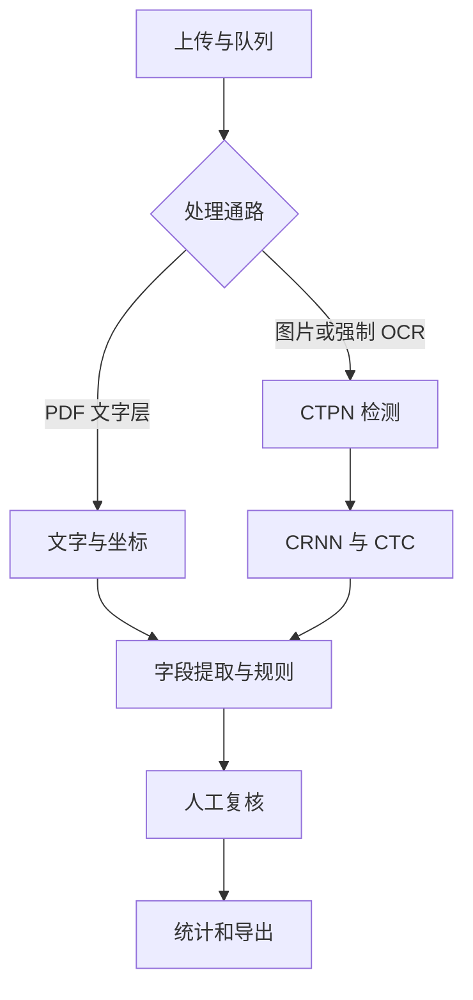

# 架构与开发说明

浏览器加载 React 预构建页面，通过同源 API 调用 FastAPI；后台单进程队列处理上传，SQLite 保存业务与审计，文件系统保存原件和预览。

## 指定网络

CTPN 为原始 VGG16 的 13 个卷积加 RPN 卷积，stride=16 特征图的每一行输入隐藏维 128 的双向 LSTM，再经 512 维线性投影、十组锚框分类和回归。后处理执行概率筛选、NMS、相邻锚框图连接，生成文本行。

转换按原冻结图映射参数，将 TensorFlow i,j,f,o 门顺序改为 PyTorch i,f,g,o，并加入原图 forget_bias=1；线性投影之后不能擅加 ReLU。以 OpenVINO 读取并执行的原冻结图作为数值参考，不声称运行过独立 TensorFlow 环境。三尺寸实际误差保留在转换报告。

CRNN 为七层卷积、两层隐藏维 256 的双向 LSTM 与字符投影，输入固定高度 32、动态宽度，输出 time × batch × 6736。字符表 6735 个字符，标签 0 为 blank。训练使用 CTCLoss；推理先合并相邻重复标签，再移除 blank，例如 A,A,blank,A 得到 AA。

暗照片曝光归一化、长表格横线处理、邻行碎片清理和空列间距压缩属于输入处理。标签明确但号码格式不完整、或金额小数点缺失时，可在同一 CRNN 上以不同宽度重读，只采用实际输出候选，不补写数字或从其他字段反推税额。

运行时使用 CPU ONNX Runtime 1.23.2，启动前校验模型 SHA-256；关闭遥测。模型或依赖不齐直接报错，指定网络模块不导入、不调用 PP-OCR。图像记录 engine=ctpn_crnn_ctc，PDF 直接提取为 pdf_text，旧版比较为 ppocr，分别保留。

## 业务一致性

上传配置和模型版本参与文件去重；同一原件可分别验证文字层与图像通道。不同文件中相同票号仍标记业务重复并阻止确认。金额使用 Decimal，未知值保存 null。修改携带 revision，旧版本冲突被拒绝；保存后退回复核，统计仅含人工确认且不重复的票据。

文件级处理完成后再写入，避免后页失败留下半份记录。中断任务重启后标记失败，已成功文件可重新导入并跳过。限制大小、页数、像素与 ZIP 路径，Excel/CSV 导出处理公式风险和长数字类型。

## 主要代码

`reader.py` 路由格式和识别模式；`classic_ocr` 是指定网络；`parser.py` 提取和验证；`service.py` 队列、去重与统计；`exporter.py` 导出；`main.py` API；`frontend/src` 为七个页面和复核交互。训练和数值转换与日常运行依赖分开。
